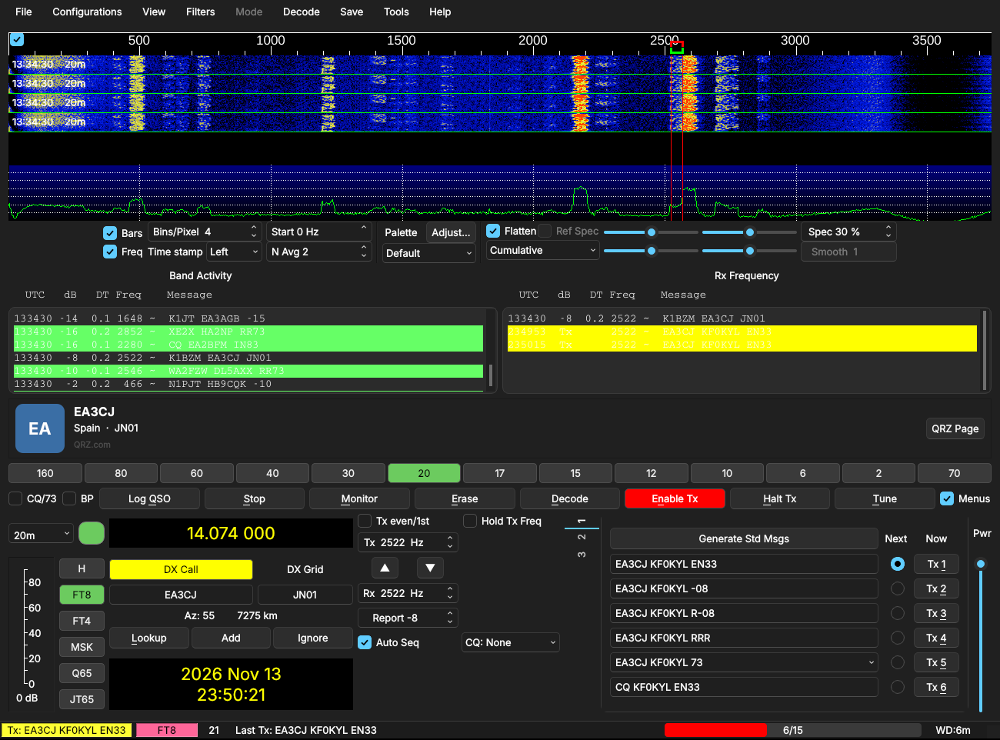
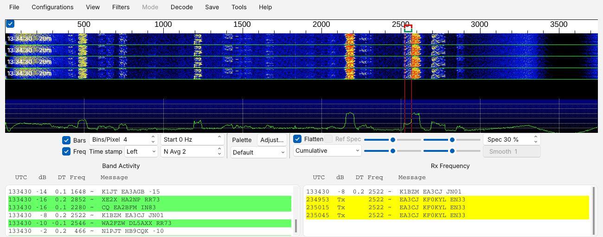
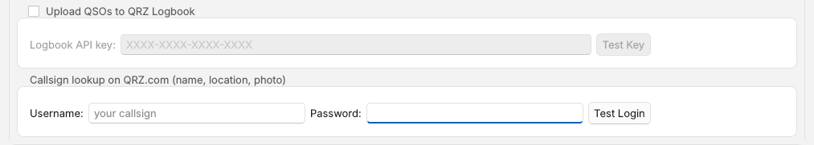

<p align="center">
  
</p>

<h1 align="center">KF0KYL Digi</h1>

<p align="center">
  <b>FT8, FT4 and weak-signal digital modes with a modern look, built on WSJT-X.</b><br>
  Dark mode · waterfall in the main window · automatic QRZ Logbook upload · see who you're working
</p>

<p align="center">
  <a href="https://github.com/ccoo26/KF0KYL-Digi/releases/latest"><b>⬇ Download the latest release</b></a>
</p>



KF0KYL Digi is a modified version of **WSJT-X 3.0.2** by Joe Taylor, K1JT, and the WSJT
Development Team, maintained by Carson Coordes, KF0KYL. It decodes and transmits exactly
like WSJT-X (same modes, same decoders, same rig control) with a cleaner interface and a
few conveniences added on top.

> **Not the official WSJT-X.** KF0KYL Digi is an independent, unofficial version and is
> not endorsed by the WSJT Development Team. Please report problems with it
> [here on GitHub](https://github.com/ccoo26/KF0KYL-Digi/issues), not to the WSJT-X groups.

---

## What's different from WSJT-X

### 🌙 Windows 11 look and dark mode
A clean, modern theme with rounded controls, a blue accent colour, thin scroll bars and
properly styled checkboxes, sliders and spinners. Turn dark mode on or off from
**View → Use Dark Style**. On Windows the title bar goes dark too.



### 📈 Waterfall in the main window
The waterfall sits right above the decode panes, so there's one window to manage instead
of two. Drag the divider to give it more or less room. Want it in its own window again,
say on a second monitor? Untick **View → Waterfall in Main Window** and it pops back out;
tick it to bring it home. Your layout is remembered.

### ☁️ Automatic upload to your QRZ Logbook
Every contact you log is sent to your [QRZ.com Logbook](https://logbook.qrz.com) the moment
it's logged, whether you click OK in the log window or have logging set to automatic.

- **No duplicates.** It only sends the contact being logged, never your whole log, and it
  remembers what it has already uploaded (even across restarts), so the same QSO is never
  sent twice.
- **Internet down? Nothing is lost.** Contacts wait in a queue and are retried
  automatically until they go through.
- **No pop-ups.** Results show quietly in the status bar, e.g. *"QRZ: W1AW uploaded to logbook"*.

### 👤 See who you're working
When you call a station, answer a CQ, or someone replies to *your* CQ and auto-sequencing
picks them up, a strip under the decodes shows who they are: **name, city, state/country,
grid, licence class and their QRZ photo**, plus a **QRZ Page** button that opens their full
QRZ.com page in your browser.


- With a **QRZ.com login** you get the details from QRZ (a QRZ XML subscription gives the
  full set; free accounts get limited data).
- **US calls** are filled in from FCC licence data even without a QRZ login.
- **Everyone else** still shows the country, and the QRZ Page button always works.
- Hide or show the strip with **View → Callsign Info**.

### 🧳 Lives alongside WSJT-X
KF0KYL Digi keeps its own settings and log, so you can keep the official WSJT-X installed
too. **The first time it starts it copies your WSJT-X settings, log and history over**, so
there's nothing to set up again. Your WSJT-X files are left untouched.

---

## Download and install

Get the files from the **[Releases page](https://github.com/ccoo26/KF0KYL-Digi/releases/latest)**.

| You have | Download |
|---|---|
| Windows 10 / 11 (64-bit) | `kf0kyldigi-…-windows-x86_64` installer (`.exe`) |
| Raspberry Pi 4 / 5 (or 3B+) | `kf0kyldigi-…-linux-aarch64.deb` |
| Linux PC | `kf0kyldigi-…-linux-x86_64.AppImage` or `.deb` |

### Windows
1. Run the installer. Windows may say it *"protected your PC"* because the installer isn't
   code-signed. Click **More info → Run anyway**.
2. Start **KF0KYL Digi** from the Start menu. It installs under `C:\KF0KYL` and does not
   replace an existing WSJT-X.

### Raspberry Pi
You need the **64-bit** Raspberry Pi OS based on Debian 13 "Trixie" (or Ubuntu 24.04).
Check with `uname -m` (should say `aarch64`).

```bash
sudo apt update
sudo apt install ./kf0kyldigi-*-linux-aarch64.deb
```

It appears in the main menu (usually under **Sound & Video**) as **KF0KYL Digi**. On Linux it replaces the official
`wsjtx` package (they share program files), so the two can't be installed at the same time.

Pi tips: a Pi 4 or 5 is comfortable (use **Decode → Deep** freely); a Pi 3B+ works with
**Decode → Normal**. Make sure the clock is synchronised (`timedatectl` should say
*System clock synchronized: yes*) and use a USB sound card or your rig's USB audio.

---

## Setting up the QRZ features

Open **File → Settings → Advanced**:



- **Upload QSOs to QRZ Logbook:** tick it and paste your *Logbook API key* from
  QRZ.com → My Logbook → Settings, then click **Test Key**. QRZ requires a subscription
  for logbook uploads, and the station callsign in KF0KYL Digi must match the logbook.
- **Callsign lookup on QRZ.com:** enter your QRZ username and password and click
  **Test Login**. It tells you whether your account gets full or limited data.

Your key and password are stored only in KF0KYL Digi's settings file on your computer.

---

## Works with your other ham software

Everything else works just like WSJT-X 3.0.2, and the
[WSJT-X User Guide](https://wsjt.sourceforge.io/wsjtx.html) applies. Programs that talk to
WSJT-X over UDP (JTAlert, GridTracker, loggers such as Log4OM and N1MM+) work as usual.
They see the program name *KF0KYL Digi* and the WSJT-X version it's based on.
PSK Reporter spots are identified as KF0KYL Digi.

---

## Questions

**Is it safe to run alongside WSJT-X?** Yes on Windows: separate install folder, settings
and log. Just don't run both on the same radio at the same time.

**Where are my settings?** Windows: the `%LOCALAPPDATA%\KF0KYL Digi\` folder holds
`KF0KYL Digi.ini` and your log, ALL.TXT and QRZ upload history. Linux:
`~/.config/KF0KYL Digi.ini` and `~/.local/share/KF0KYL Digi/`. Use
**File → Open log directory** to jump there.

**My WSJT-X settings didn't come over.** They're copied only on the very first start, and
version 1.0.0 missed them on Windows (fixed in 1.0.1). To copy them by hand, close
KF0KYL Digi, then copy `%LOCALAPPDATA%\WSJT-X\WSJT-X.ini` into `%LOCALAPPDATA%\KF0KYL Digi\`
and rename it to `KF0KYL Digi.ini`. Copy `wsjtx_log.adi` and `qrz_uploaded.txt` too.

**Found a bug or have an idea?** Open an
[issue](https://github.com/ccoo26/KF0KYL-Digi/issues).

---

## Building from source

Every push to this repository is built automatically by GitHub Actions for Windows, Linux
x86-64 and Linux ARM64 (see `.github/workflows`). To build locally, follow the WSJT-X
build instructions in [INSTALL](INSTALL); nothing extra is needed.

A dated list of every change from WSJT-X 3.0.2 is in [MODIFICATIONS.md](MODIFICATIONS.md),
and the full history is in the commit log.

---

## Credits and licence

KF0KYL Digi exists because of **WSJT-X** and the years of work by Joe Taylor, K1JT, and the
WSJT Development Team: Bill Somerville G4WJS, Steve Franke K9AN, Nico Palermo IV3NWV,
Uwe Risse DG2YCB, Brian Moran N9ADG, Roger Rehr W3SZ, John Nelson G4KLA, Charlie Suckling
DL3WDG, Terrell Deppe KJ5HST and many contributors. The original WSJT-X README is kept in
[README-WSJT-X.md](README-WSJT-X.md).

Like WSJT-X, KF0KYL Digi is free software under the **GNU General Public License v3** (see
[COPYING](COPYING)): you're free to use, study, share and modify it, and the complete
source code is right here.

"WSJT-X" is a trademark of the WSJT Development Team; KF0KYL Digi uses its own name and
icon in line with their [trademark policy](TRADEMARK.md).

73 de KF0KYL
